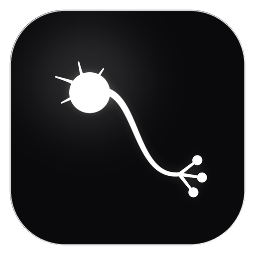

# Axon

**Un second cerveau pour toi, ton équipe et vos IA.** Tes notes deviennent une mémoire que Claude, Cursor, Codex
ou Gemini partagent ; tu la vois en 3D ; vos projets à plusieurs vivent dans un cerveau commun.

## Installer (Windows 10 et 11)
1. Ouvre la **[dernière version](../../releases/latest)** → section **Assets** → télécharge **`Axon-Setup-<version>.exe`**.
2. Double-clique dessus → **Installer**. Pas de terminal, pas besoin de Node.js.
3. Premier lancement : **Continuer avec GitHub** (ou Google), ton prénom, puis le dossier de ton cerveau.

Windows peut afficher « Windows a protégé votre ordinateur » (l'installateur n'est pas encore signé) :
**Informations complémentaires → Exécuter quand même**.

Les mises à jour sont automatiques : quand une nouvelle version sort, Axon propose **« Redémarrer pour mettre à jour »**.

## Ce dépôt
Il ne contient que les **installateurs**. Le code source d'Axon est privé.
Licence : [LICENSE](LICENSE) — utilisation gratuite, pas de copie ni de redistribution du logiciel.

## Tes données
Tes notes restent des fichiers sur ton PC (ou ton Google Drive). Axon ne les envoie à aucun serveur : la connexion sert
seulement à te relier à ton équipe pour les projets de groupe.
